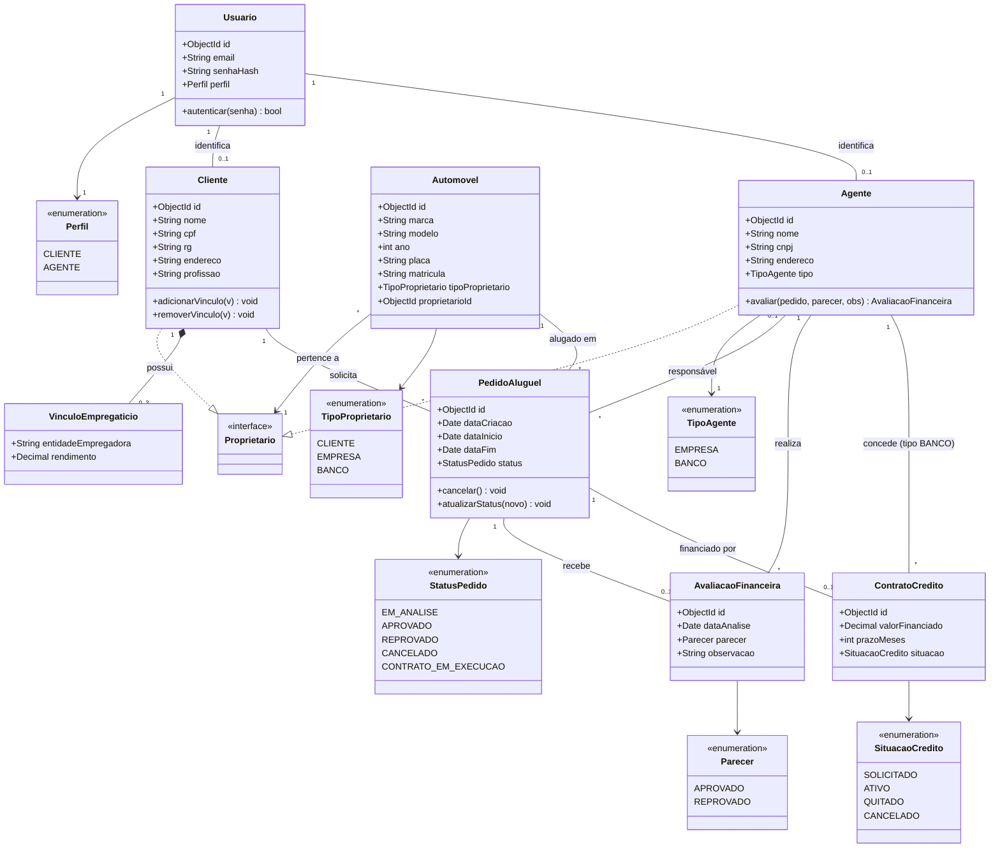
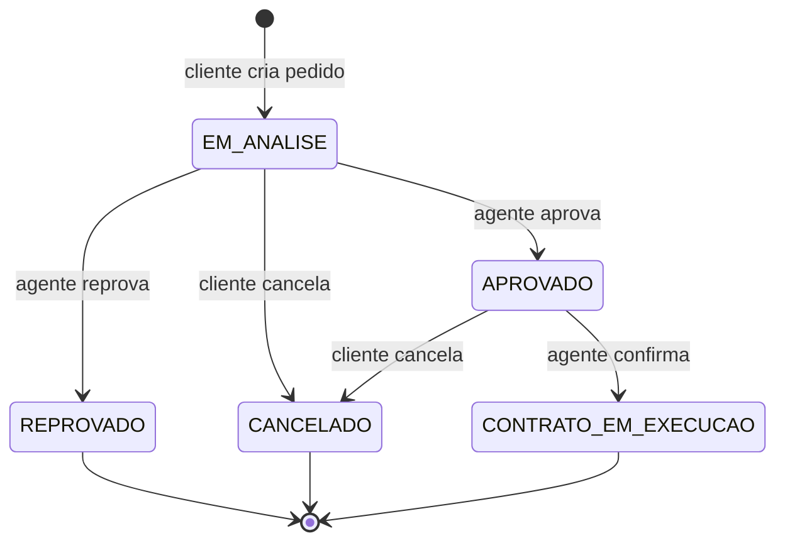

# 🧬 Diagrama de Classes

Renderizado automaticamente pelo GitHub (Mermaid).

## Regras de negócio refletidas no modelo

| Regra | Onde é garantida |
|-------|------------------|
| Máx. 3 vínculos por cliente | Multiplicidade `0..3` + validação no model/service |
| Contrato de crédito só por agente tipo Banco | Restrição `{agente.tipo = BANCO}` validada no service |
| Automóvel sempre com proprietário | Multiplicidade `1` em `Automovel → Proprietario` |
| Só agente avalia; avaliação registra o agente | `AvaliacaoFinanceira` obrigatoriamente ligada a `Agente`; rota protegida por perfil |
| Cliente só mexe nos próprios pedidos | Verificação `pedido.cliente == usuarioLogado` no controller/service |
| Pedido cancelado não é aprovado nem executado | Máquina de estados abaixo |

## Máquina de estados do pedido

